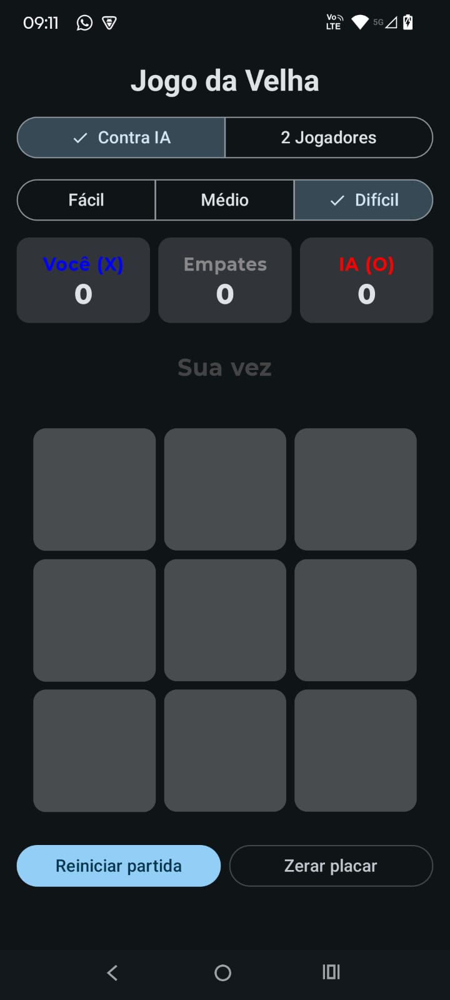
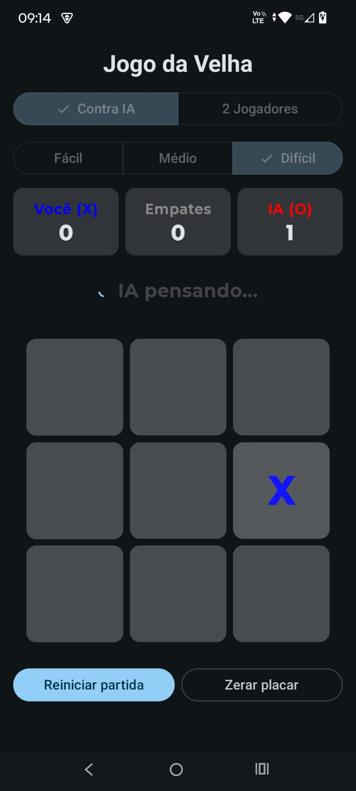
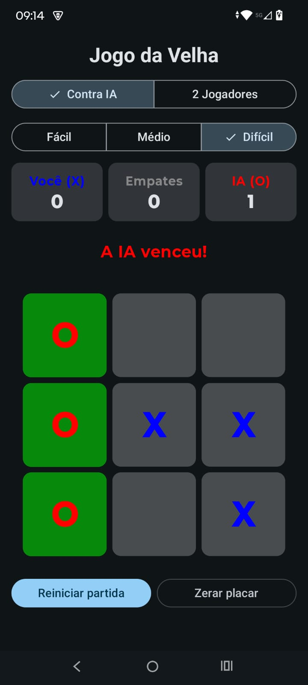
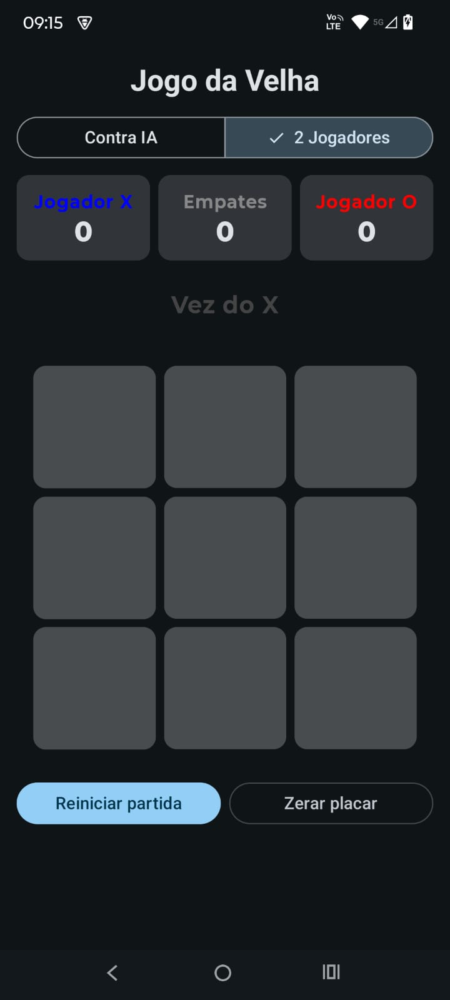

# Jogo da Velha com IA

Jogo da Velha para Android feito em **Kotlin** e **Jetpack Compose**, com dois modos de jogo:

- **Contra IA** — o jogador (X) enfrenta a máquina (O) em três níveis de dificuldade.
- **2 Jogadores** — modo clássico, dois jogadores no mesmo aparelho (Player vs Player).

## Funcionalidades

- Grade 3x3 feita com composables; células ocupadas ficam bloqueadas.
- Painel de status: de quem é a vez, "IA pensando…" (com indicador de progresso), vitória ou empate.
- Validação de vitória em linhas, colunas e diagonais e de empate a cada jogada; a linha vencedora é destacada.
- Tabuleiro desativado ao fim da partida e enquanto a IA está pensando.
- Seletor de modo (Contra IA / 2 Jogadores) e seletor de dificuldade (Fácil / Médio / Difícil).
- Placar separado por modo, com vitórias do X (jogador), do O (IA ou segundo jogador) e empates.
  O placar é mantido durante a sessão, inclusive ao girar a tela ou se o Android encerrar o app em
  segundo plano (`SavedStateHandle`).
- Botões **Reiniciar partida** e **Zerar placar** (zera só o placar do modo atual).

## Screenshots

<!-- Salve as imagens em docs/screenshots/ com estes nomes (ou ajuste os caminhos abaixo). -->

| Contra IA | IA pensando | Vitória | 2 Jogadores |
|:---:|:---:|:---:|:---:|
|  |  |  |  |

## Estratégia da Inteligência Artificial

Todas as IAs implementam a mesma interface e usam as regras puras de `GameLogic`
(`checkWinner`, `isDraw`, `availableMoves`, `applyMove`), sem duplicar lógica de jogo:

```kotlin
interface AiPlayer {
    fun chooseMove(board: List<Player?>, aiPlayer: Player): Int
}
```

A `AiFactory` escolhe a implementação conforme a dificuldade selecionada.

### Fácil — `EasyAi`

Escolhe uma célula vazia **aleatória**. Não tem estratégia nenhuma, então é fácil de vencer.

### Médio — `MediumAi`

Heurística com regras em ordem de prioridade:

1. Se pode **vencer** nesta jogada, vence.
2. Se o jogador pode vencer na próxima jogada, **bloqueia**.
3. Pega o **centro**, se estiver livre.
4. Pega um **canto** livre (escolhido aleatoriamente).
5. Senão, joga em qualquer célula livre.

Joga de forma razoável, mas não enxerga armadilhas de mais de uma jogada (por exemplo, quando o
jogador cria duas ameaças ao mesmo tempo), então ainda é possível vencê-la.

### Difícil — `HardAi` (Minimax com poda alfa-beta)

O Jogo da Velha é pequeno o bastante para a IA simular **todas** as continuações possíveis da
partida e escolher a melhor jogada. Com isso ela joga de forma perfeita: **nunca perde** — no
máximo empata.

**Minimax.** A partir do tabuleiro atual, a IA monta mentalmente uma árvore: cada nó é um
tabuleiro e cada filho é o resultado de uma jogada possível. Quando a partida termina (folha da
árvore), o tabuleiro recebe uma pontuação:

| Resultado          | Pontuação     |
|--------------------|---------------|
| Vitória da IA      | `10 - depth`  |
| Vitória do jogador | `depth - 10`  |
| Empate             | `0`           |

`depth` é o número de jogadas simuladas até ali. Por isso a IA prefere **vencer o mais rápido
possível** e, se a derrota fosse inevitável, **perder o mais tarde possível**.

As pontuações sobem pela árvore alternando os jogadores:

- na vez da IA (nó **maximizador**), escolhe-se o filho de **maior** pontuação;
- na vez do jogador (nó **minimizador**), supõe-se que ele joga o melhor possível para ele, ou
  seja, escolhe-se o filho de **menor** pontuação.

**Poda alfa-beta.** Durante a busca são guardados dois limites:

- `alpha`: a melhor pontuação que a IA já tem garantida naquele caminho;
- `beta`: a melhor pontuação que o jogador já tem garantida.

Quando `beta <= alpha`, o adversário nunca deixaria a partida chegar àquele ponto (ele já tem
uma alternativa melhor em outro ramo), então os ramos restantes são descartados sem mudar o
resultado. Isso reduz bastante a quantidade de tabuleiros avaliados.

**Detalhes de implementação:**

- `chooseMove` avalia cada jogada disponível com `minimax` e retorna a de maior pontuação.
- Em caso de empate na pontuação, prefere **centro**, depois **cantos**, depois **bordas**.
- Com o tabuleiro vazio, retorna o centro direto (todas as jogadas empatam com jogo perfeito,
  então não vale a pena explorar a árvore inteira).

### Turno da IA no app

Depois de uma jogada válida do jogador no modo Contra IA, o `GameViewModel`:

1. marca `isAiThinking = true` (o tabuleiro e os seletores ficam desativados);
2. inicia uma coroutine em `viewModelScope`, espera 500 ms (para a jogada parecer natural) e
   calcula a jogada em `Dispatchers.Default`, para o Minimax não travar a interface;
3. aplica a jogada, verifica vitória/empate, atualiza o placar e libera o tabuleiro.

Reiniciar a partida, trocar de modo ou de dificuldade cancela a jogada em andamento. Além disso,
cada partida tem um identificador, e uma jogada calculada para uma partida antiga é descartada —
ela nunca é aplicada no tabuleiro novo.

## Arquitetura

O projeto segue **MVVM** com fluxo de dados unidirecional: a tela observa um `StateFlow<GameUiState>`
e envia eventos ao ViewModel; os composables não têm lógica de jogo (state hoisting).

```
app/src/main/java/com/example/app_jogo_da_velha/
├── MainActivity.kt
├── model/            Player, GameMode, Difficulty, Score, GameUiState
├── domain/
│   ├── GameLogic.kt  regras puras (vitória, empate, jogadas disponíveis)
│   └── ai/           AiPlayer, EasyAi, MediumAi, HardAi, AiFactory
├── viewmodel/        GameViewModel (turnos, IA, placar, SavedStateHandle)
└── ui/
    ├── GameScreen.kt
    ├── components/   BoardGrid, Cell, StatusPanel, ScoreBoard, ModeSelector, DifficultySelector
    └── theme/
```

## Como compilar e executar

### Requisitos

- [Android Studio](https://developer.android.com/studio) atualizado (o projeto usa Android Gradle
  Plugin 9.3 e Gradle 9.5).
- Android SDK com a API 37 instalada (o Android Studio oferece a instalação ao sincronizar).
- JDK 21 — o Gradle baixa automaticamente se não estiver instalado.
- Aparelho ou emulador com **Android 7.0 (API 24)** ou superior.

### Pelo Android Studio

1. Clone o repositório:
   ```bash
   git clone https://github.com/apccarvalho/jogo-da-velha-com-ia.git
   ```
2. No Android Studio, use **File › Open** e selecione a pasta do projeto.
3. Aguarde o *Gradle Sync* terminar.
4. Escolha um emulador ou conecte um aparelho com a depuração USB ativada.
5. Clique em **Run ▶** (configuração `app`).

### Pela linha de comando

Na pasta do projeto (no Windows, use `gradlew.bat` no lugar de `./gradlew`):

```bash
# Gera o APK de debug em app/build/outputs/apk/debug/app-debug.apk
./gradlew assembleDebug

# Instala no aparelho/emulador conectado
./gradlew installDebug

# Roda os testes unitários
./gradlew test
```

## Testes

Os testes unitários ficam em `app/src/test` e rodam na JVM, sem emulador:

- **GameLogicTest** — as 8 linhas de vitória, empate, partida em andamento, `availableMoves` e `applyMove`.
- **EasyAiTest** — sempre escolhe uma célula vazia (100 tabuleiros aleatórios).
- **MediumAiTest** — vence com duas em linha, bloqueia o jogador, prefere vencer a bloquear, centro e cantos.
- **HardAiTest** — vence quando pode, bloqueia quando precisa, nunca joga em célula ocupada,
  **não perde nenhuma de 200 partidas contra a IA Fácil** e **empata contra si mesma**.
- **GameViewModelTest** — placares separados por modo, troca de modo, zerar placar, estado
  restaurado após recriar o ViewModel, a IA jogando sozinha e o cancelamento da jogada da IA ao
  reiniciar ou trocar a dificuldade.
